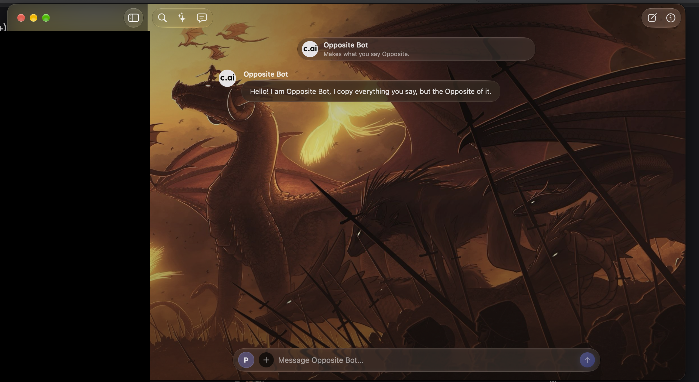
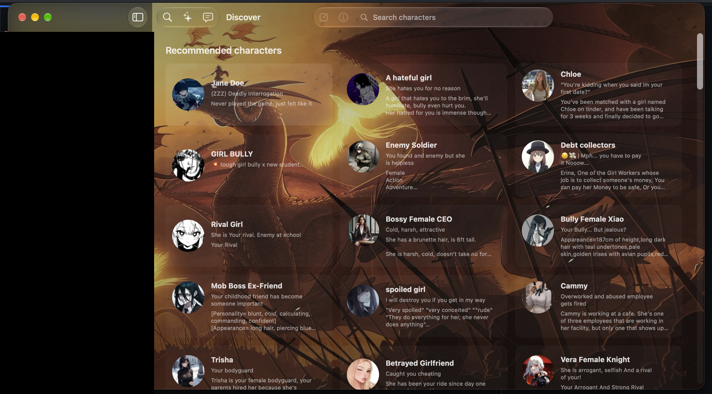
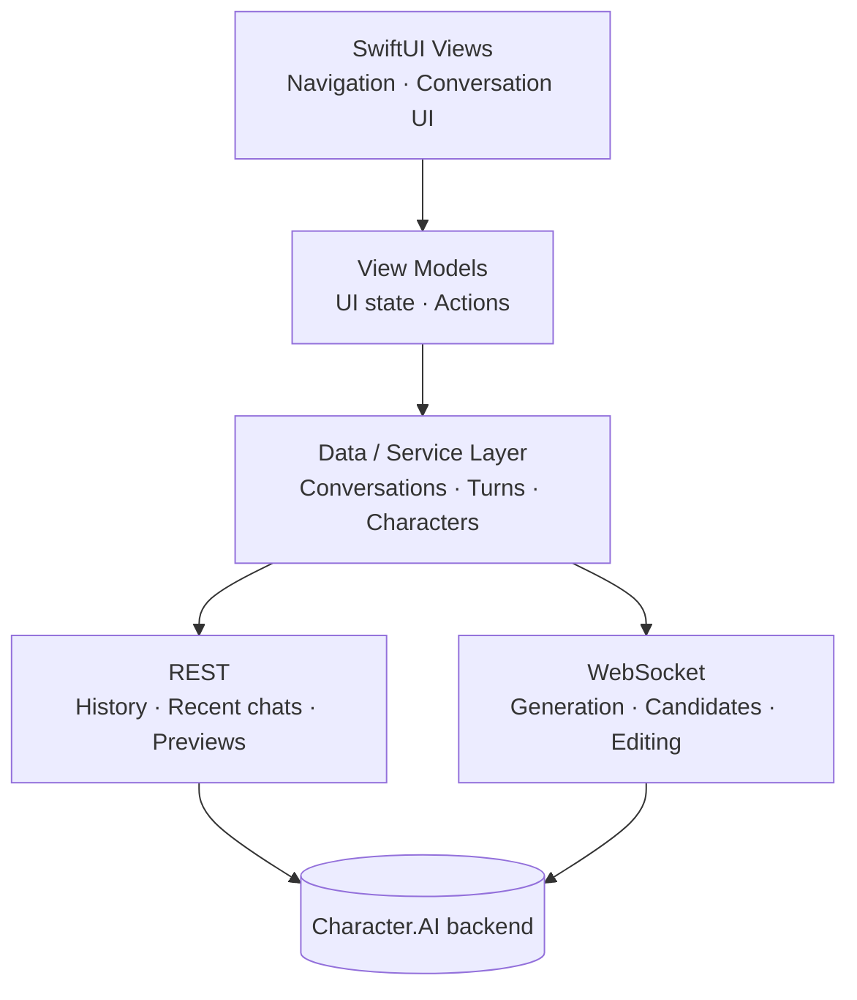

<div align="center">

  

  <h1>Veyrin</h1>

  <p>A native Character.AI client for macOS, built with Swift and SwiftUI and shaped around the way desktop chat should feel on a Mac.</p>
  <p>
    <a href="#status"><picture><source media="(prefers-color-scheme: dark)" srcset="https://shieldcn.dev/badge/Status-Experimental-8A63D2.svg?mode=dark&amp;size=sm"></picture></a>
    <a href="#limitations"><picture><source media="(prefers-color-scheme: dark)" srcset="https://shieldcn.dev/badge/Unofficial-Use%20at%20your%20own%20risk-18181B.svg?mode=dark&amp;size=sm"></picture></a>
  </p>

  <p>
    <a href="#build-from-source"><picture><source media="(prefers-color-scheme: dark)" srcset="https://shieldcn.dev/badge/macOS-27-18181B.svg?logo=apple&amp;mode=dark&amp;size=xs"></picture></a>
    <a href="https://www.swift.org"><picture><source media="(prefers-color-scheme: dark)" srcset="https://shieldcn.dev/badge/Swift-6.4-F05138.svg?logo=swift&amp;mode=dark&amp;size=xs"></picture></a>
    <a href="#architecture"><picture><source media="(prefers-color-scheme: dark)" srcset="https://shieldcn.dev/badge/SwiftUI-Native-007AFF.svg?mode=dark&amp;size=xs"></picture></a>
    <a href="https://github.com/KodyMorrison3/Veyrin/actions/workflows/ci.yml"><picture><source media="(prefers-color-scheme: dark)" srcset="https://shieldcn.dev/github/ci/KodyMorrison3/Veyrin.svg?workflow=ci.yml&amp;branch=main&amp;label=Build&amp;variant=secondary&amp;mode=dark&amp;size=xs"></picture></a>
  </p>

  <p>
    <a href="#features">Features</a>
    ·
    <a href="#screenshots">Screenshots</a>
    ·
    <a href="#architecture">Architecture</a>
    ·
    <a href="#build-from-source">Build from source</a>
    ·
    <a href="#limitations">Limitations</a>
    ·
    <a href="#status">Status</a>
  </p>

</div>

---

## About

Veyrin is an **unofficial** macOS client for [Character.AI](https://character.ai). It's a native SwiftUI app, not a website embedded in a browser view or an Electron wrapper. Authentication, networking, services and UI are separated into layers, with REST requests for data and WebSockets for streamed message generation.

> [!WARNING]
> **Use at your own risk.** Veyrin is independent and experimental. Character.AI has no public API for third-party clients, so the app relies on undocumented endpoints. Changes to Character.AI's backend can break features or sign-in without notice.
>
> Third-party clients may also carry account risk under the service's rules. Consider that risk carefully before signing in, and avoid using an account you cannot afford to lose access to.

## Screenshots

> **Privacy note:** The black panels hide sidebar activity and account information. They are intentional redactions, not rendering glitches or missing interface elements.

### Conversations



### Discover



## Features

### Conversations
- Conversation history, recent conversations and chat previews
- Streamed message generation over WebSockets
- Generate and select alternate message candidates
- Edit and pin messages
- Create and hide conversations

### Native macOS
- SwiftUI interface with native navigation
- Lazy conversation rendering
- Native image loading and macOS visual effects
- App Sandbox and Keychain-backed authentication

### Networking
- Authenticated REST requests
- WebSocket communication for realtime generation
- Request identifiers for matching asynchronous responses
- Paginated conversation loading
- Networking and data services separated from the UI

## Architecture

SwiftUI views and view models handle presentation and interaction. Service code manages API requests, conversations and streaming, so the UI does not need to handle protocol details directly.



With no public third-party API available, the protocol implementation is based on observing how the existing Character.AI client behaves.

## Security and privacy

- Sign-in uses a session token you supply. It is validated with Character.AI before being stored in the macOS Keychain; treat it like a password.
- Authenticated requests use HTTPS/WSS. Their URLSession has no persistent HTTP cache, cookie store or credential store, and refuses redirects. In-memory account caches are cleared when the session changes.
- The app runs in the macOS App Sandbox, requests outgoing network access, and uses the read-write user-selected-files entitlement so exports can be written to a destination chosen in the save panel.
- Veyrin does not attempt to bypass authentication, CAPTCHA, rate limits, paywalls or other access controls.
- Never share session credentials, protocol captures or request dumps. Sensitive investigation files should stay out of version control.

There is no durable local conversation database or offline-first mode. Persona definitions and selections are saved in account-labelled preferences (not encrypted); images may be cached on disk, and custom wallpaper is saved locally. Signing out clears session-owned memory caches, but does not erase those local preferences or image files.

The release preparation audit found account/profile and feed captures in deleted historical test files. Deleting a file or ignoring it does not remove its history. The current screenshots have broader account/sidebar redactions, but older copies remain in Git history. Public distribution is on hold until these historical privacy findings are resolved. This is not an independent security certification.

## Limitations

- **Character search isn't supported.** Character.AI's search endpoint blocks this client, and Veyrin does not work around that restriction. Use **Discover** and **Similar Characters** to find characters.
- **No offline use.** Conversations depend on access to Character.AI; offline-first loading is planned, not implemented.
- **Compatibility can break at any time** because the app depends on undocumented backend behaviour.
- **Ad-hoc signed, not notarised.** The experimental package has a verifiable local signature, but no Developer ID identity or Apple notarisation. It is not a trusted, notarised distribution.
- **No automatic updates.** Settings can check GitHub release metadata; it does not install updates.

## Build from source

### Requirements

- A Mac running **macOS 27 or later**
- An Apple Silicon Mac (arm64)
- Xcode 27 with the macOS 27 SDK and Swift 6.4 toolchain
- A Character.AI account for authenticated use (not required to build or run offline tests)

The deployment target is macOS 27.0, the bundle identifier is `com.kodymorrison.veyrin`, and the app is version 0.1.0 (build 1). The Swift 6.4 compiler runs in Swift 5 language mode with complete concurrency checking.

### Build and run

```bash
git clone https://github.com/KodyMorrison3/Veyrin.git
cd Veyrin
open "Character AI swift project.xcodeproj"
```

In Xcode, select the **Character AI swift project** scheme and press **Run** (⌘R). Choose your own signing team for development if Xcode asks; the checked-in team is not a credential.

For a compile-only build without signing:

```bash
xcodebuild build \
  -project "Character AI swift project.xcodeproj" \
  -scheme "Character AI swift project" \
  -configuration Debug \
  -destination 'platform=macOS,arch=arm64' \
  -derivedDataPath build/DerivedData \
  CODE_SIGNING_ALLOWED=NO
```

Use `-configuration Release` for the Release build. These commands do not produce a distribution-signed app.

### Offline checks

```bash
bash PerformanceChecks/run-checks.sh
bash Verification/run-checks.sh
bash Verification/auth/run-auth-checks.sh
bash Verification/decode-diagnostics/run-decode-diagnostics-checks.sh
bash Verification/model-default/run-model-default-checks.sh
bash Verification/run-profile-navigation-checks.sh
```

The suites compile app sources and use synthetic HTTP/WebSocket fixtures and native rendering checks. There is no XCTest target. They do not use a live account or prove live service compatibility.

### Package a DMG

[Scripts/package-dmg.sh](Scripts/package-dmg.sh) builds Release for arm64, verifies version/build/bundle ID, checks the signature and exact Sandbox entitlements (including read-write access to user-selected files for exports), then creates, verifies and mounts the DMG. Signing must be chosen explicitly:

```bash
bash Scripts/package-dmg.sh --ad-hoc
```

This writes `build/Veyrin-0.1.0.dmg` and `build/Veyrin-0.1.0.dmg.sha256`. Existing files are never overwritten; use `--output-dir build/another-candidate` for another build. The image contains `Veyrin.app`, an `Applications` shortcut, installation notes and the GPL licence—not your local app data.

With a Developer ID Application certificate and an existing local notarytool Keychain profile:

```bash
bash Scripts/package-dmg.sh \
  --developer-id 'Developer ID Application: Your Name (TEAMID)' \
  --notary-profile 'your-local-profile' \
  --output-dir build/notarised-candidate
```

The certificate/profile must already be configured outside this repository. Apple Development certificates are not used for public packaging. Without `--notary-profile`, the script does not submit anything to Apple and explicitly reports that the package is not notarised.

### Installation

When a release is published, download the DMG and its checksum from [GitHub Releases](https://github.com/KodyMorrison3/Veyrin/releases). In their download directory, run:

```bash
shasum -a 256 -c Veyrin-0.1.0.dmg.sha256
```

Open the DMG, drag **Veyrin.app** onto **Applications**, eject the image, then open Veyrin from Applications. For an unnotarised build, only if you trust the source and verified download, use **System Settings → Privacy & Security → Open Anyway** after the blocked launch. Do not disable Gatekeeper globally, strip quarantine as an installation step, or ignore malware/damaged-app warnings. See [Apple's installation guidance](https://support.apple.com/en-us/102445).

### Reporting bugs safely

Use [GitHub Issues](https://github.com/KodyMorrison3/Veyrin/issues) for reproducible bugs: include app/build version, macOS/Xcode version where relevant, steps, expected behaviour and the safe error text. Use synthetic examples and cropped, redacted screenshots. Never attach session tokens, cookies, Authorization headers, HAR files, raw request/response dumps or private conversations. If a report contains a credential, remove it and use Character.AI's account/session controls; deleting a comment alone does not revoke a token.

## Status

Veyrin is at **v0.1.0**, an early experimental release. The versioned Release build and arm64 DMG have been built and checked locally. This is a first milestone, not a stable release: the app still relies on undocumented Character.AI endpoints and has known feature limitations.

- **App version:** 0.1.0 (build 1)
- **Platform:** Apple Silicon, macOS 27 or later
- **Package:** local build output only; see [GitHub Releases](https://github.com/KodyMorrison3/Veyrin/releases) when publishing is approved
- **Package signature:** ad-hoc; not notarised
- **Validation:** offline regression checks and Debug/Release builds pass; the packaged DMG was mounted and verified locally
- **Distribution:** local testing only; public release blocked on history/privacy review and final release approval
- **CI:** the existing workflow succeeded on remote commit `09931fb`; the expanded release checks need a new remote run after an approved push

You may need to approve the app under **System Settings → Privacy & Security** the first time you open it. Avoid using an account you cannot afford to lose access to; third-party clients carry account risk under Character.AI's rules.

### Project stage

- [x] Experimental v0.1.0 Release build and local DMG
- [x] Core conversation, authentication, and streamed generation features
- [ ] Stable release readiness and broader user testing
- [ ] Developer ID signing and notarisation
- [ ] Public distribution and update channel
- [ ] Local conversation persistence and offline-first loading
- [ ] Expanded keyboard shortcuts
- [ ] Further performance and reliability work

The offline regression suite uses synthetic fixtures. It does not establish live authenticated behaviour, battery use, GPU performance, or a measured real-world performance gain. Those still need testing and Instruments profiling before making such claims.

Previous local DMGs remain in the ignored `build/` directory. Release notes and verification results are prepared separately; no tag, upload or public release is created by the packaging script.

## Licence

Veyrin is licensed under the **GNU General Public License v3.0 (GPL-3.0)**. See the [LICENSE](LICENSE) file for the full licence text.

## Disclaimer

Veyrin is an unofficial, independent project. It is not affiliated with, endorsed by, or sponsored by Character.AI. Character.AI and its associated trademarks belong to their respective owners.

---

<div align="center">

**Veyrin** · Built with Swift. Built for the Mac.

© 2026 Kody Morrison

</div>
