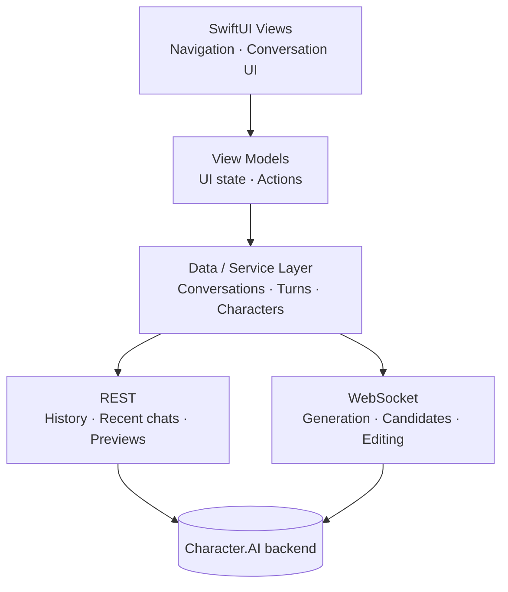

<div align="center">

  

  <h1>Veyrin</h1>

  <p>A native Character.AI client for macOS, built with Swift and SwiftUI and shaped around the way desktop chat should feel on a Mac.</p>
  <p>
    <a href="#status"><picture><source media="(prefers-color-scheme: dark)" srcset="https://shieldcn.dev/badge/Status-Experimental-8A63D2.svg?mode=dark&amp;size=sm"></picture></a>
    <a href="#limitations"><picture><source media="(prefers-color-scheme: dark)" srcset="https://shieldcn.dev/badge/Unofficial-Use%20at%20your%20own%20risk-18181B.svg?mode=dark&amp;size=sm"></picture></a>
  </p>

  <p>
    <a href="#build-from-source"><picture><source media="(prefers-color-scheme: dark)" srcset="https://shieldcn.dev/badge/macOS-27-18181B.svg?logo=apple&amp;mode=dark&amp;size=xs"></picture></a>
    <a href="https://www.swift.org"><picture><source media="(prefers-color-scheme: dark)" srcset="https://shieldcn.dev/badge/Swift-6.4-F05138.svg?logo=swift&amp;mode=dark&amp;size=xs"></picture></a>
    <a href="#architecture"><picture><source media="(prefers-color-scheme: dark)" srcset="https://shieldcn.dev/badge/SwiftUI-Native-007AFF.svg?mode=dark&amp;size=xs"></picture></a>
    <a href="https://github.com/KodyMorrison3/Character-AI-native-swift-client-project/actions/workflows/ci.yml"><picture><source media="(prefers-color-scheme: dark)" srcset="https://shieldcn.dev/github/ci/KodyMorrison3/Character-AI-native-swift-client-project.svg?workflow=ci.yml&amp;branch=main&amp;label=Build&amp;variant=secondary&amp;mode=dark&amp;size=xs"></picture></a>
  </p>

  <p>
    <a href="#features">Features</a>
    ·
    <a href="#screenshots">Screenshots</a>
    ·
    <a href="#architecture">Architecture</a>
    ·
    <a href="#build-from-source">Build from source</a>
    ·
    <a href="#limitations">Limitations</a>
    ·
    <a href="#status">Status</a>
  </p>

</div>

---

## About

Veyrin is an **unofficial** macOS client for [Character.AI](https://character.ai). It's a native SwiftUI app, not a website embedded in a browser view or an Electron wrapper. Authentication, networking, services and UI are separated into layers, with REST requests for data and WebSockets for streamed message generation.

> [!WARNING]
> **Use at your own risk.** Veyrin is independent and experimental. Character.AI has no public API for third-party clients, so the app relies on undocumented endpoints. Changes to Character.AI's backend can break features or sign-in without notice.
>
> Third-party clients may also carry account risk under the service's rules. Consider that risk carefully before signing in, and avoid using an account you cannot afford to lose access to.

## Screenshots

> **Privacy note:** The black boxes visible in these screenshots are intentional redactions to protect personal information and private Character.AI activity. They are not rendering glitches or missing UI elements.

### Conversations


### Discover


## Features

### Conversations
- Conversation history, recent conversations and chat previews
- Streamed message generation over WebSockets
- Generate and select alternate message candidates
- Edit and pin messages
- Create and hide conversations

### Native macOS
- SwiftUI interface with native navigation
- Lazy conversation rendering
- Native image loading and macOS visual effects
- App Sandbox and Keychain-backed authentication

### Networking
- Authenticated REST requests
- WebSocket communication for realtime generation
- Request identifiers for matching asynchronous responses
- Paginated conversation loading
- Networking and data services separated from the UI

## Architecture

SwiftUI views and view models handle presentation and interaction. Service code manages API requests, conversations and streaming, so the UI does not need to handle protocol details directly.



With no public third-party API available, the protocol implementation is based on observing how the existing Character.AI client behaves.

## Security and privacy

- Authentication secrets are stored in the macOS Keychain.
- The app runs in the macOS App Sandbox and requests outgoing network access.
- Veyrin does not attempt to bypass authentication, CAPTCHA, rate limits, paywalls or other access controls.
- Never share session credentials, protocol captures or request dumps. Sensitive investigation files should stay out of version control.

Local conversation persistence is still in development. Conversations are currently loaded from Character.AI, and a durable local conversation database is not yet available.

## Limitations

- **Character search isn't supported.** Character.AI's search endpoint blocks this client, and Veyrin does not work around that restriction. Use **Discover** and **Similar Characters** to find characters.
- **No offline use.** Conversations depend on access to Character.AI; offline-first loading is planned, not implemented.
- **Compatibility can break at any time** because the app depends on undocumented backend behaviour.

## Build from source

### Requirements

- A Mac running **macOS 27 or later**
- Xcode with the macOS 27 SDK
- A Character.AI account

The deployment target is macOS 27, so earlier versions are not supported by the current build configuration.

### Build and run

```bash
git clone https://github.com/KodyMorrison3/Character-AI-native-swift-client-project.git
cd Character-AI-native-swift-client-project
open "Character AI swift project.xcodeproj"
```

In Xcode, select the **Character AI swift project** scheme and press **Run** (⌘R).

### Package a DMG

`Scripts/package-dmg.sh` builds the Release configuration, seals the bundle and writes `build/Veyrin-<version>.dmg`:

```bash
./Scripts/package-dmg.sh
```

It signs with a Developer ID certificate when one is available, otherwise the local Apple Development certificate, otherwise ad-hoc, and it aborts rather than shipping a bundle that fails signature verification. Notarisation is skipped unless `NOTARY_PROFILE` names a `xcrun notarytool store-credentials` profile, so the script works without a paid Apple Developer Program membership. The SHA-256 of the finished image is printed for the release notes.

## Status

Veyrin is in active development. The native interface, authentication, conversation features and streamed generation are implemented. The app has been built and tested locally, but it is not yet distributed as a public release.

- [x] Native macOS interface and navigation
- [x] Authentication and Keychain-backed credential storage
- [x] Conversation history and chat management
- [x] Streamed message generation and candidate handling
- [ ] Local conversation persistence and caching
- [ ] Offline-first loading
- [ ] Expanded keyboard shortcuts
- [ ] Further reliability and performance work
- [ ] Signed and notarised distribution

**DMG status:** A DMG has been built and tested locally, but no public release has been published. The image is **not signed with a Developer ID certificate and not notarised**, because both require a paid Apple Developer Program membership. macOS therefore treats the app as unidentified and blocks the first launch until you allow it, either from **System Settings → Privacy & Security** or by Control-clicking the app and choosing **Open**. The DMG is arm64 only and requires macOS 27, so it does not run on Intel Macs or earlier releases. Building from source is the recommended route at this stage.

## Licence

Veyrin is licensed under the **GNU General Public License v3.0 (GPL-3.0)**. See the [LICENSE](LICENSE) file for the full licence text.

## Disclaimer

Veyrin is an unofficial, independent project. It is not affiliated with, endorsed by, or sponsored by Character.AI. Character.AI and its associated trademarks belong to their respective owners.

---

<div align="center">

**Veyrin** · Built with Swift. Built for the Mac.

© 2026 Kody Morrison

</div>
