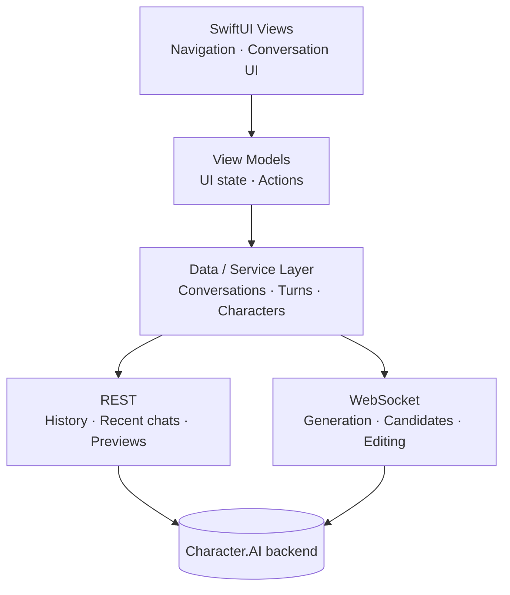

<div align="center">


<h1>Veyrin</h1>

<p>A native Character.AI client for macOS, built with Swift and SwiftUI, designed around the way desktop chat should feel on a Mac.</p>

<p>
  <a href="#status"><picture><source media="(prefers-color-scheme: dark)" srcset="https://shieldcn.dev/badge/Status-Experimental-8A63D2.svg?mode=dark&amp;size=sm"></picture></a>
  <a href="#limitations"><picture><source media="(prefers-color-scheme: dark)" srcset="https://shieldcn.dev/badge/Unofficial-Use%20at%20your%20own%20risk-18181B.svg?mode=dark&amp;size=sm"></picture></a>
</p>

<p>
  <a href="#build-from-source"><picture><source media="(prefers-color-scheme: dark)" srcset="https://shieldcn.dev/badge/macOS-27-18181B.svg?logo=apple&amp;mode=dark&amp;size=xs"></picture></a>
  <a href="https://www.swift.org"><picture><source media="(prefers-color-scheme: dark)" srcset="https://shieldcn.dev/badge/Swift-6.4-F05138.svg?logo=swift&amp;mode=dark&amp;size=xs"></picture></a>
  <a href="#architecture"><picture><source media="(prefers-color-scheme: dark)" srcset="https://shieldcn.dev/badge/SwiftUI-Native-007AFF.svg?mode=dark&amp;size=xs"></picture></a>
  <a href="https://github.com/KodyMorrison3/Veyrin/actions/workflows/ci.yml"><picture><source media="(prefers-color-scheme: dark)" srcset="https://shieldcn.dev/github/ci/KodyMorrison3/Veyrin.svg?workflow=ci.yml&amp;branch=main&amp;label=Build&amp;variant=secondary&amp;mode=dark&amp;size=xs"></picture></a>
</p>

<p>
  <a href="#features">Features</a>
  ·
  <a href="#screenshots">Screenshots</a>
  ·
  <a href="#architecture">Architecture</a>
  ·
  <a href="#build-from-source">Build from source</a>
  ·
  <a href="#limitations">Limitations</a>
  ·
  <a href="#status">Status</a>
</p>

</div>

---

## About

Veyrin is an **unofficial native macOS client** for [Character.AI](https://character.ai), built with Swift and SwiftUI.

Rather than embedding the website in a browser view or wrapping it in Electron, Veyrin uses native macOS interface components. The app separates its interface, view models, networking and data services, with REST requests handling data retrieval and WebSockets handling streamed message generation.

> [!WARNING]
> **Veyrin is experimental. Use it at your own risk.**
>
> Character.AI does not provide a public API for this project. Veyrin relies on undocumented endpoints, which means changes to Character.AI's website or backend can break features or authentication without notice.
>
> Using an unofficial client may also carry account-related risks under Character.AI's rules. Consider these risks carefully before signing in.

## Screenshots

> **Privacy note:** The black boxes in these screenshots are intentional redactions to protect personal information and private Character.AI activity. They are not rendering glitches or missing interface elements.

### Conversations


### Discover


## Features

### Conversations

- Browse conversation history and recent conversations.
- View chat previews.
- Generate messages with streamed responses over WebSockets.
- Generate and select alternate message candidates.
- Edit and pin messages.
- Create and hide conversations.

### Native macOS

- SwiftUI interface with native navigation.
- Lazy conversation rendering.
- Image loading with caching and thumbnailing.
- Native macOS visual effects.
- App Sandbox support.
- Keychain-backed authentication storage.

### Networking

- Authenticated REST requests.
- WebSocket communication for streamed generation.
- Request identifiers for matching asynchronous responses.
- Paginated conversation loading.
- Separate networking and data services, keeping protocol details out of the UI.

## Architecture

SwiftUI views and view models handle presentation and interaction. Service code manages requests, conversations and streaming, so the interface does not need to handle protocol details directly.



Because Character.AI does not provide a public third-party API for this use case, the protocol implementation depends on observed behaviour of its existing client. That behaviour can change without notice.

## Security and privacy

- Authentication secrets are stored in the macOS Keychain.
- The app uses the macOS App Sandbox and requests outgoing network access.
- Veyrin does not attempt to bypass authentication, CAPTCHA, rate limits, paywalls or other access controls.
- Session credentials, protocol captures and request dumps can contain sensitive information and must not be shared.
- Sensitive investigation files and personal conversation data should stay out of version control.

**Treat your session credentials like a password.** Anyone who obtains a valid session token may be able to access your account session. Never include tokens, authentication headers or private conversation content in GitHub issues or diagnostic reports.

Local conversation persistence is still in development. Conversations are currently loaded from Character.AI, and a durable local conversation database is not yet available.

This project has not undergone a formal independent security audit.

## Limitations

- **Character search is not supported.** Character.AI's search endpoint blocks this client, and Veyrin does not attempt to work around that restriction. Use **Discover** and **Similar Characters** to find characters where available.
- **No offline use.** Conversations depend on access to Character.AI. Offline-first loading is planned, not implemented.
- **No durable local conversation database yet.** Conversation history is currently loaded from Character.AI.
- **Compatibility is not guaranteed.** The app relies on undocumented backend behaviour that may change at any time.
- **Unsigned and not notarised.** The current DMG is not Developer ID signed and notarised. macOS may display a security warning when you attempt to open it.
- **Experimental status.** Expect bugs, incomplete workflows and breaking changes.

## Build from source

### Requirements

- A Mac running **macOS 27 or later**.
- Xcode with the macOS 27 SDK.
- An Apple Silicon Mac (arm64).
- A Character.AI account for authenticated use.

The current deployment target is macOS 27, so earlier versions are not supported by this build configuration.

### Clone the repository

```bash
git clone https://github.com/KodyMorrison3/Veyrin.git
cd Veyrin
```

### Build

Open the Xcode project:

```bash
open "Character AI swift project.xcodeproj"
```

In Xcode, select the **Character AI swift project** scheme and build or run the app.

Alternatively, build the Release configuration from Terminal:

```bash
xcodebuild \
  -project "Character AI swift project.xcodeproj" \
  -scheme "Character AI swift project" \
  -configuration Release \
  -destination 'platform=macOS' \
  CODE_SIGNING_ALLOWED=NO \
  build
```

### Packaging a DMG

The intended packaging workflow uses `Scripts/package-dmg.sh` to build and package the app into a DMG.

**Check that `Scripts/package-dmg.sh` exists in the repository before relying on this command.** If the script is not present in your checkout, the command below will not work.

```bash
./Scripts/package-dmg.sh
```

The distributed build described in this README is ad-hoc signed and has not been notarised. A public release should clearly identify this limitation. Developer ID signing and notarisation would provide a smoother installation experience for users.

## Status

Veyrin is at **v0.1.0**, an early experimental milestone. The app has been built and tested locally, but it should not be considered a stable release.

- **App version:** 0.1.0 (build 1)
- **Platform:** Apple Silicon (arm64), macOS 27 or later
- **Package:** `build/Veyrin-0.1.0.dmg`, if present in your local build output
- **Package signature:** Ad-hoc; not notarised
- **Validation:** Offline regression checks and Debug/Release builds have passed locally, according to the project's development notes
- **Live testing:** Offline checks do not establish that every feature works with a live, authenticated Character.AI account
- **Distribution:** Check the [GitHub Releases page](https://github.com/KodyMorrison3/Veyrin/releases) for published builds

If macOS prevents the app from opening, review the security warning and only proceed if you trust the source and build. Avoid using an account you cannot afford to lose access to, as unofficial clients may carry account-related risks.

### Project roadmap

- [x] Experimental v0.1.0 Release build and local DMG
- [x] Core conversation, authentication and streamed generation features
- [ ] Stable release readiness and broader user testing
- [ ] Developer ID signing and notarisation
- [ ] Public distribution and an update channel
- [ ] Local conversation persistence and offline-first loading
- [ ] Expanded keyboard shortcuts
- [ ] Further performance and reliability work

The offline regression suite uses synthetic fixtures. It does not, by itself, establish live authenticated behaviour, battery use, GPU performance or measured real-world performance gains. Those require additional testing and profiling.

## Licence

Veyrin is licensed under the **GNU General Public License v3.0 (GPL-3.0)**. See the [LICENSE](LICENSE) file for the full licence text.

## Disclaimer

Veyrin is an unofficial, independently developed project. It is not affiliated with, endorsed by or sponsored by Character.AI. Character.AI and its associated names and trademarks belong to their respective owners.

This software is provided "as is", without warranty of any kind. You are responsible for how you use it and for complying with applicable terms and laws. Compatibility, availability and continued operation are not guaranteed.

---

<div align="center">

**Veyrin** · Built with Swift. Built for the Mac.

© 2026 Kody Morrison

</div>
