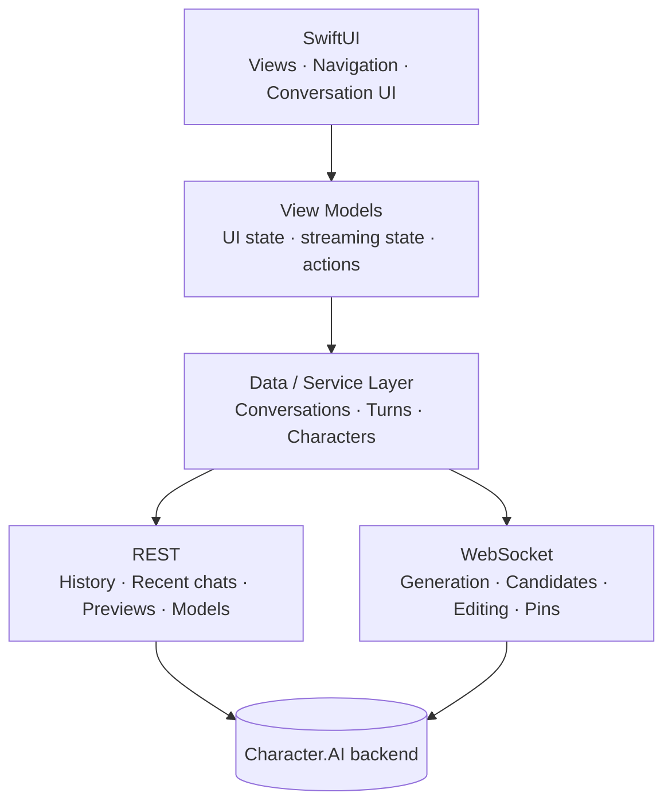

<div align="center">


# Veyrin

**A native Character.AI client for macOS, built with Swift and SwiftUI.**


[Features](#features) · [Architecture](#architecture) · [Getting started](#getting-started) · [Roadmap](#roadmap)

<br>


</div>

---

## About

Veyrin is an **unofficial** macOS client for [Character.AI](https://character.ai). It is not a web wrapper or an Electron app, and it doesn't embed a browser. It has its own native interface, authentication layer, networking layer, data models and realtime WebSocket implementation.

| | |
|---|---|
| **Native** | SwiftUI from the ground up |
| **Realtime** | WebSocket-based, streamed generation |
| **Secure** | Keychain-backed sessions, App Sandbox |
| **Lightweight** | No bundled browser engine |

> [!WARNING]
> Veyrin is experimental. Character.AI has no public API for third-party clients, so backend changes can break functionality without warning.

## Features

**Conversations**

- [x] Conversation history, recent conversations and chat previews
- [x] Realtime, streamed message generation
- [x] Candidate generation and selection
- [x] Message editing and pinning
- [x] Conversation creation and hiding

**Native macOS**

- [x] SwiftUI interface with native navigation
- [x] Lazy conversation rendering
- [x] Native image loading and macOS visual effects
- [x] App Sandbox
- [x] Keychain authentication

**Networking**

- [x] Authenticated REST requests
- [x] WebSocket communication with streaming
- [x] Per-request identifiers for matching async responses
- [x] Paginated conversation loading
- [x] Networking and data layer separate from the UI

See the [roadmap](#roadmap) for what's planned.

## Screenshots

<div align="center">

| Conversation | Character browsing |
|:---:|:---:|
|  |  |

*Placeholders. Real screenshots will be added once the UI and branding are finalised.*

</div>

## Architecture

The UI is kept separate from the networking implementation, so the SwiftUI layer never needs to know about protocol details. That makes it possible to change how data is fetched, cached or synchronised without reworking the interface.



### Protocol

The protocol layer is based on observing how the existing Character.AI client behaves, since no public API exists.

**REST** covers authentication, conversation history, recent conversations, chat previews, available models, conversation creation and management, pinned turns and hidden conversations.

**WebSocket** covers realtime operations:

`create_chat` · `create_and_generate_turn` · `generate_turn_candidate` · `edit_turn_candidate` · `update_primary_candidate` · `set_turn_pin`

Each request carries its own identifier so asynchronous responses can be matched to the operation that started them.

### Performance

Current approach:

- `URLSession` and `URLSessionWebSocketTask` for networking
- `LazyVStack` with stable turn identities for conversation rendering
- Lightweight data models and no polling loops

Next optimisation work, guided by profiling in Instruments rather than assumptions: conversation caching → incremental sync → batched streaming updates → Markdown rendering → image caching → memory and GPU usage.

### Local-first direction

A longer-term goal is to make conversations open instantly: load local state, render immediately, then sync with the server and apply changes. Local conversation data will be kept separate from authentication credentials.

## Security

| Data | Stored in |
|---|---|
| Authentication secrets | macOS Keychain |
| Conversation data | Local cache/database (planned) |
| Temporary network state | Memory |

- The app is sandboxed with only the network permissions it needs.
- Protocol captures, credentials, HAR files and request dumps are excluded from version control.
- Veyrin does not attempt to bypass authentication, CAPTCHA, rate limits, paywalls or other access controls.

## Project structure

```text
Character AI swift project/
├── Authentication/   AuthStore, KeychainStore
├── Networking/       ConversationService, WebSocket handling, API models
├── Models/           Character, Conversation, Turn
├── ViewModels/       ChatViewModel
├── Views/            Chat, Characters, Conversations
└── Resources/
```

The structure is still evolving as the client moves toward persistent local state and a fuller data layer.

## Getting started

Veyrin is a development project with no packaged release yet, so you'll build it from source.

**Requirements**

- A Mac running macOS 26 or later
- Xcode with the macOS 26 SDK (Swift 6)
- A Character.AI account

**Build and run**

```bash
git clone https://github.com/KodyMorrison3/Character-AI-native-swift-client-project.git
cd Character-AI-native-swift-client-project
open "Character AI swift project.xcodeproj"
```

Then select the app scheme in Xcode and press **Run** (⌘R).

## Roadmap

| Phase | Focus | Status |
|---|---|---|
| **1. Foundation** | REST, WebSockets, authentication, conversations, streaming, SwiftUI | ✅ Done |
| **2. Experience** | Branding, navigation, keyboard shortcuts, error and loading states, session lifecycle | ⬜ Planned |
| **3. Local state** | Persistence, conversation cache, incremental sync, background refresh, image cache | ⬜ Planned |
| **4. Performance** | Instruments profiling, streaming batching, memory, request deduplication, large chats | ⬜ Planned |
| **5. Release** | Production config, signing, app icon, documentation, distribution | ⬜ Planned |

## Disclaimer

Veyrin is an unofficial, independent project. It is not affiliated with, endorsed by, or sponsored by Character.AI. Character.AI and its associated trademarks belong to their respective owners. Veyrin is intended for personal, educational and software-development purposes.

---

<div align="center">

**Veyrin** · Built with Swift. Built for the Mac.

© 2026 Kody Morrison

</div>
