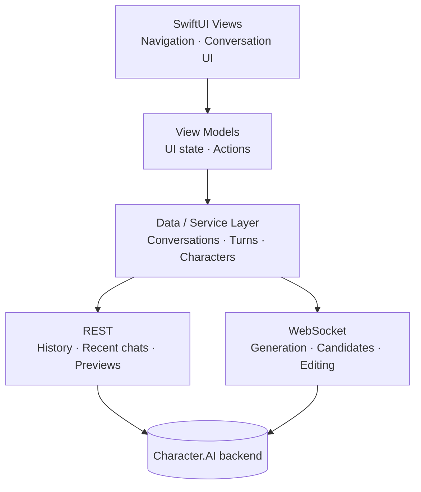

<div align="center">


# Veyrin

**A native macOS client for Character.AI, built with Swift and SwiftUI.**


[Features](#features) · [Screenshots](#screenshots) · [Build from source](#build-from-source) · [Limitations](#limitations)

</div>

---

## About

Veyrin is an **unofficial** macOS client for [Character.AI](https://character.ai). It uses a native SwiftUI interface rather than embedding a website in a browser view or shipping an Electron runtime. The app has separate authentication, networking, service and UI layers, including REST requests and WebSocket-based message streaming.

> [!WARNING]
> Veyrin is an independent, experimental project. Character.AI does not provide a public API for third-party clients, so this app relies on undocumented endpoints. Changes on Character.AI's side can break features or sign-in without notice. Use it at your own discretion.

## Screenshots

Screenshots of the conversation and character discovery interfaces will be added here.

## Features

### Conversations
- Conversation history, recent conversations and chat previews
- Streamed message generation over WebSockets
- Generate and select alternate message candidates
- Edit and pin messages
- Create and hide conversations

### Native macOS
- SwiftUI interface with native navigation
- Lazy conversation rendering
- Native image loading and macOS visual effects
- App Sandbox and Keychain-backed authentication

### Networking
- Authenticated REST requests
- WebSocket communication for realtime generation
- Request identifiers for matching asynchronous responses
- Paginated conversation loading
- Networking and data services separated from the UI

## Architecture

The UI is separated from the networking implementation. SwiftUI views and view models handle presentation and interaction, while service code manages API requests, conversations and streaming.



The protocol implementation is based on observing the existing Character.AI client because no public third-party API is available.

## Security and privacy

- Authentication secrets are stored in the macOS Keychain.
- The app uses the macOS App Sandbox and requests outgoing network access.
- Veyrin does not attempt to bypass authentication, CAPTCHA, rate limits, paywalls or other access controls.
- Do not share session credentials, protocol captures or request dumps.

Conversation persistence is still evolving; do not assume all conversation data is stored in a durable local database.

## Build from source

### Requirements

- A Mac running **macOS 27 or later**
- Xcode with the macOS 27 SDK
- A Character.AI account

The current deployment target is macOS 27. Earlier macOS versions are not supported by this build configuration.

### Build and run

```bash
git clone https://github.com/KodyMorrison3/Character-AI-native-swift-client-project.git
cd Character-AI-native-swift-client-project
open "Character AI swift project.xcodeproj"
```

In Xcode, select the **Character AI swift project** scheme and press **Run** (⌘R).

## Distribution status

A locally tested DMG has been built, but a public release has not been published in this repository yet.

The current DMG is **unsigned and not notarised**. macOS may display a security warning and block the app from opening by default. This build does not have Developer ID signing or Apple notarisation, so it should not be presented as a signed or notarised release.

## Current status

The core native interface, authentication flow, conversation features and streaming implementation are in place. Persistent local conversation state and further reliability work remain ongoing. Because the app depends on undocumented Character.AI behaviour, compatibility may change at any time.

## Disclaimer

Veyrin is an unofficial, independent project. It is not affiliated with, endorsed by, or sponsored by Character.AI. Character.AI and its associated trademarks belong to their respective owners.

---

<div align="center">

**Veyrin** · Built with Swift. Built for the Mac.

© 2026 Kody Morrison

</div>
