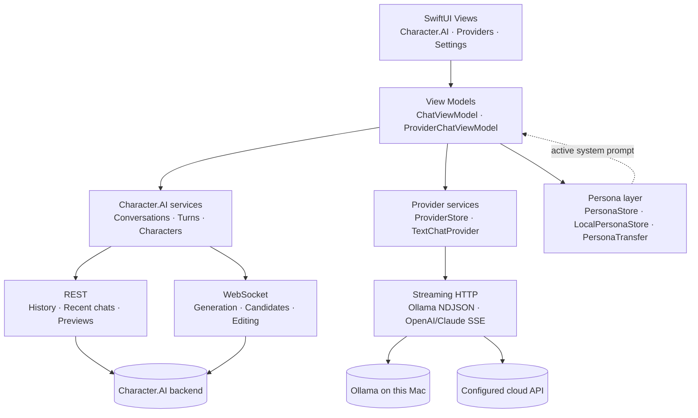

<div align="center">

  

  <h1>Veyrin</h1>

  <p>A native macOS AI client for Character.AI, local Ollama models and configured cloud providers, built with Swift and SwiftUI.</p>
  <p>
    <a href="#status"><picture><source media="(prefers-color-scheme: dark)" srcset="https://shieldcn.dev/badge/Status-Experimental-8A63D2.svg?mode=dark&amp;size=sm"></picture></a>
    <a href="#limitations"><picture><source media="(prefers-color-scheme: dark)" srcset="https://shieldcn.dev/badge/Unofficial-Use%20at%20your%20own%20risk-18181B.svg?mode=dark&amp;size=sm"></picture></a>
  </p>

  <p>
    <a href="#build-from-source"><picture><source media="(prefers-color-scheme: dark)" srcset="https://shieldcn.dev/badge/macOS-27-18181B.svg?logo=apple&amp;mode=dark&amp;size=xs"></picture></a>
    <a href="https://www.swift.org"><picture><source media="(prefers-color-scheme: dark)" srcset="https://shieldcn.dev/badge/Swift-6.4-F05138.svg?logo=swift&amp;mode=dark&amp;size=xs"></picture></a>
    <a href="#architecture"><picture><source media="(prefers-color-scheme: dark)" srcset="https://shieldcn.dev/badge/SwiftUI-Native-007AFF.svg?mode=dark&amp;size=xs"></picture></a>
    <a href="https://github.com/KodyMorrison3/Veyrin/actions/workflows/ci.yml"><picture><source media="(prefers-color-scheme: dark)" srcset="https://shieldcn.dev/github/ci/KodyMorrison3/Veyrin.svg?workflow=ci.yml&amp;branch=main&amp;label=Build&amp;variant=secondary&amp;mode=dark&amp;size=xs"></picture></a>
  </p>

  <p>
    <a href="#features">Features</a>
    ·
    <a href="#screenshots">Screenshots</a>
    ·
    <a href="#architecture">Architecture</a>
    ·
    <a href="#build-from-source">Build from source</a>
    ·
    <a href="#limitations">Limitations</a>
    ·
    <a href="#progress-and-roadmap">Roadmap</a>
    ·
    <a href="#status">Status</a>
  </p>

</div>

---

## About

Veyrin is an **unofficial** macOS client for [Character.AI](https://character.ai), with separate text-chat support for Ollama and cloud providers. It's a native SwiftUI app, not a website embedded in a browser view or an Electron wrapper. Authentication, networking, services and UI are separated into layers. Character.AI keeps its REST and WebSocket implementation; local/cloud text chat uses HTTP streaming.

> [!WARNING]
> **Use at your own risk.** Veyrin is independent and experimental. Character.AI has no public API for third-party clients, so the app relies on undocumented endpoints. Changes to Character.AI's backend can break features or sign-in without notice.
>
> Third-party clients may also carry account risk under the service's rules. Consider that risk carefully before signing in, and avoid using an account you cannot afford to lose access to.

## Screenshots

> **Privacy note:** The black panels hide sidebar activity and account information. They are intentional redactions, not rendering glitches or missing interface elements.

### Conversations


### Discover


## Features

### Providers
- Native provider chooser at launch: **Character.AI**, **Local Models**, **Cloud Providers**
- Switch providers without restarting; Character.AI keeps its existing sign-in, history and character features
- Ollama connection testing, installed-model selection and streamed text responses through a configurable loopback endpoint. Opening **Local Models** asks the endpoint for its models and opens Ollama first when **Start Ollama automatically** is enabled in Settings (on by default); with the toggle off nothing is launched. Veyrin never downloads models
- Claude (Anthropic Messages), OpenAI Responses, OpenAI Chat Completions and explicitly configured OpenAI-compatible Chat Completions endpoints, with add/edit/test/remove controls and Keychain-backed API keys
- **Remember my last provider** is off by default. Enabling it restores the last selected provider/model after connection checks where supported; disabling it does not sign out or remove keys
- New local/cloud text chats are saved per provider, model and character under `Application Support/Veyrin/provider-chats`, and resume when reopened; **New Chat** replaces the saved conversation after confirmation. Switching providers starts a separate conversation; context is never transferred automatically. Chats are listed in a conversation sidebar beside the chat, and every mutation (edit, rewind, regenerate, fork) rewrites the saved turns
- **Free Providers** presets prefill FreeLLMAPI (a router on this Mac), Gemini, Groq, OpenRouter and Cloudflare Workers AI endpoints; keys and model IDs still come from your own account, and each provider's quota and privacy terms still apply

See [Provider setup and architecture](PROVIDERS.md) for setup, privacy boundaries, verification results and limitations. Connection tests use model listing; they do **not** prove that a model permits chat generation. No live AI connection was verified during implementation.

### Personas
- Export Character.AI personas as portable JSON or a paste-ready Markdown prompt, and import them into a local library for local/cloud chats
- Import Veyrin persona JSON, character-card JSON (v1/v2) or plain-text/Markdown prompts; import merges by persona ID rather than duplicating an existing copy
- Select and inspect a user roleplay persona in saved local-character chat beside the model picker, or in the local/cloud provider toolbar. Both show its picture, active name and read-only title, description and definition
- Imported personas and currently loaded Character.AI account personas are supported. The choice is remembered per saved character across local/cloud chats, while chats without a character keep a temporary selection. Details are sent with the character instructions only when you send a message; selecting a persona sends nothing
- JSON, Markdown/text and Export All include embedded persona pictures. Account pictures are downloaded through the existing image cache during export; imported copies keep their picture offline. Pictures are shown in the picker, details and Settings, not sent to text models. Markdown keeps its picture in a separate Avatar section; paste only the text sections into another AI. Re-importing a text-only update keeps the stored picture, and a hand-written Avatar section is treated as ordinary prose
- Character.AI account personas remain read-only. Imported copies live in `local-personas.json`, work offline and remain after sign-out

### Conversations
- Conversation history, recent conversations and chat previews
- Streamed message generation over WebSockets
- Generate and select alternate message candidates
- Edit and pin messages
- Create and hide conversations

### Local character library
- Save Discover/search characters with their bookmark button, fetching the full profile greeting; press it again to remove the saved copy, or import characters and greetings from a Character.AI account export
- Pick a saved character from **My Library**, the toolbar button beside **Switch Provider** in local/cloud provider chats. It is the same screen the Character.AI window shows, with **Start chat** and **Edit** on each character and a **No character** entry in its grid, and it replaces the chat column while open. The greeting appears immediately as the first assistant message and becomes part of the model's history when you send a message; **New Chat** restores one greeting. Changing characters after chatting requires confirmation and starts a separate transcript
- Search and filter saved characters, edit a character's About and greeting (saved in place, with the imported name, avatar, tags and source details preserved), remove a character and its local chat history after confirmation, and export the library as a Veyrin archive
- Chat with saved characters through the provider chat window using Ollama; its configurable loopback endpoint defaults to HTTP at `127.0.0.1:11434`. The chooser opens Ollama when the Settings toggle allows it, and only loopback addresses are accepted, so a key never leaves this Mac
- For local-only inference, use downloaded models and disable Ollama cloud features. A loopback address alone does not prove local inference; see [Ollama privacy/setup](PROVIDERS.md#ollama)

### Native macOS
- SwiftUI interface with native navigation
- Lazy conversation rendering
- Native image loading and macOS visual effects
- App Sandbox and Keychain-backed authentication

### Networking
- Authenticated REST requests
- WebSocket communication for realtime generation
- Request identifiers for matching asynchronous responses
- Paginated conversation loading
- Networking and data services separated from the UI

## Architecture

SwiftUI views and view models handle presentation and interaction. Service code manages API requests, conversations and streaming, so the UI does not need to handle protocol details directly.



Veyrin deliberately keeps two chat paths. Character.AI uses its own REST and WebSocket services because no public third-party API exists; that protocol is based on observing the existing client and is not forced through a generic completion API. Local and cloud chat use the separate `ChatProvider` contract implemented by `TextChatProvider`, which covers model discovery and streamed text over HTTP. Keeping those paths separate preserves Character.AI-specific features such as candidates, pins and edits while keeping provider adapters small, instead of forcing both backends through a lowest-common-denominator conversation API. [PROVIDERS.md](PROVIDERS.md#architecture-and-concurrency) describes that boundary and its extension points.

Personas are shared text rather than a third transport. Account personas come from Character.AI and are cached by `PersonaStore`; imported personas are stored offline by `LocalPersonaStore` and exchanged as JSON or Markdown through `PersonaTransfer`. When a persona is active in a provider chat, `ProviderChatViewModel` prepends its name, title, description and definition as a system message. The transcript is saved on this Mac beside the character's own local conversation, and only the selected endpoint receives the request.

## Security and privacy

- Character.AI sign-in uses a session token you supply. It is validated with Character.AI before being stored in the macOS Keychain; treat it like a password.
- Cloud API keys use separate Keychain items. Preferences contain provider names, endpoints, model IDs and an optional last-provider selection, never API keys. Editing a cloud destination requires re-entering its key and confirming trust in the endpoint.
- Local/cloud provider transport uses ephemeral URLSessions without persistent cookies, HTTP credentials or response caching, refuses redirects and does not expose server error bodies in the UI. Cloud chat sends context only to its explicitly selected endpoint.
- Authenticated requests use HTTPS/WSS. Their URLSession has no persistent HTTP cache or cookie store, and refuses redirects. An optional character-search cookie is stored as a separate Keychain item, sent only to `character.ai`, never logged, and removed on sign-out. In-memory account caches are cleared when the session changes.
- The app runs in the macOS App Sandbox, requests outgoing network access, and uses the read-write user-selected-files entitlement so exports can be written to a destination chosen in the save panel.
- Veyrin does not attempt to bypass authentication, CAPTCHA, rate limits, paywalls or other access controls.
- Never share session credentials, protocol captures or request dumps. Sensitive investigation files should stay out of version control.

The local character catalogue and local-character conversations are saved as **unencrypted JSON** under `~/Library/Application Support/Veyrin`. They remain on disk when you sign out. Character.AI conversations still do not have a durable local database or offline-first mode; Ollama local-character chats are stored separately from Character.AI conversation history. Persona definitions and selections are saved in account-labelled preferences (not encrypted); personas imported for local/cloud chats are saved separately as unencrypted JSON in `local-personas.json`; images may be cached on disk, and custom wallpaper is saved locally. Signing out clears session-owned memory caches, but does not erase those local files, preferences or image files.

The screenshots in this README are redacted. Older captures — including copies that remain in Git history — may still contain account or feed details, so treat any capture you share as public. This is not an independent security certification.

## Limitations

- **Character search needs a web session cookie.** Character.AI's search-results endpoint does not accept the app's session token. You can paste the `web-next-auth` cookie (or the whole `Cookie` header) from a signed-in browser in the login window or **Preferences → Account**. Veyrin stores it in the Keychain and sends it only to `character.ai`; it does not obtain, refresh or share the cookie itself. Without it, suggestions, Discover and Similar Characters still work.
- **No offline use for Character.AI conversations.** They depend on access to Character.AI; offline-first loading is planned, not implemented. The local character library can be used with Ollama running on this Mac.
- **Character.AI compatibility can break at any time** because that integration depends on undocumented backend behaviour.
- **Cloud support is text-only.** Choose Anthropic Messages, OpenAI Responses or Chat Completions to match the model. Custom endpoints must document OpenAI-compatible Chat Completions and Bearer authentication. Tools/MCP, images, Codex/ChatGPT subscription sign-in and arbitrary vendor protocols are not implemented. A successful model-list request is not a successful chat test.
- **Provider text chats are saved only on this Mac.** They are separate from Character.AI conversation history and no local-to-cloud context migration is performed. Persona references are remembered per saved character; selection in a chat without a character is temporary. Deleted/unavailable personas are shown as unavailable and their details are not sent.
- **Persona transfer:** Character.AI personas appear in **Settings → Personas** after a Character.AI chat has loaded them; export does not add a new persona to the Character.AI account. Persona exports embed a PNG avatar thumbnail, including Markdown/text exports. An unavailable account picture stops export without replacing the destination file. Older files still import, but an image omitted by an old export cannot be recovered from that file. Only JSON/Markdown/character-card files can be imported; standalone image/card-PNG import and character-card export are not implemented.
- **Ad-hoc signed, not notarised.** The experimental package has a verifiable local signature, but no Developer ID identity or Apple notarisation. It is not a trusted, notarised distribution.
- **No automatic updates.** Settings can check GitHub release metadata; it does not install updates.

## Build from source

### Requirements

- A Mac running **macOS 27 or later**
- An Apple Silicon Mac (arm64)
- Xcode 27 with the macOS 27 SDK and Swift 6.4 toolchain
- A Character.AI account for Character.AI features, Ollama with a downloaded model for local chat, or your own cloud API key for cloud chat; none is required to build or run offline tests

The deployment target is macOS 27.0, the bundle identifier is `com.kodymorrison.veyrin`, and the app is version 0.1.0 (build 1). The Swift 6.4 compiler runs in Swift 5 language mode with complete concurrency checking. The app uses the third-party Swift Package Manager dependencies ZipArchive and SystemPackage.

### Build and run

```bash
git clone https://github.com/KodyMorrison3/Veyrin.git
cd Veyrin
open "Character AI swift project.xcodeproj"
```

In Xcode, select the **Character AI swift project** scheme and press **Run** (⌘R). Choose your own signing team for development if Xcode asks; the checked-in team is not a credential.

For a compile-only build without signing:

```bash
xcodebuild build \
  -project "Character AI swift project.xcodeproj" \
  -scheme "Character AI swift project" \
  -configuration Debug \
  -destination 'platform=macOS,arch=arm64' \
  -derivedDataPath build/DerivedData \
  CODE_SIGNING_ALLOWED=NO
```

Use `-configuration Release` for the Release build. These commands do not produce a distribution-signed app.

### Offline checks

```bash
bash PerformanceChecks/run-checks.sh
bash Verification/run-checks.sh
bash Verification/auth/run-auth-checks.sh
bash Verification/decode-diagnostics/run-decode-diagnostics-checks.sh
bash Verification/model-default/run-model-default-checks.sh
bash Verification/run-profile-navigation-checks.sh
```

The suites compile app sources and use synthetic HTTP/WebSocket fixtures and native rendering checks. There is no XCTest target. They do not use a live account or prove live service compatibility. [ProviderChecks.swift](Verification/ProviderChecks.swift), included in the main verification script, covers provider routing/preferences, session gates, model discovery, NDJSON/SSE parsing, cancellation, switching during generation, retry and credential/endpoint handling. [PersonaChecks.swift](Verification/PersonaChecks.swift) covers portable persona JSON/Markdown/character-card parsing, local-library merge/export/delete, provider system-prompt injection and native layout. See [provider verification notes](PROVIDERS.md#verification) for actual results and checks still needed.

Before importing a character archive/account export or exporting the library, Veyrin asks you to confirm a neutral content notice. Imported and saved characters may be third-party content and rights may not be specified; you are responsible for respecting the source service's terms and creators' rights. This is general information, not legal advice.

### Package a DMG

[Scripts/package-dmg.sh](Scripts/package-dmg.sh) builds Release for arm64, verifies version/build/bundle ID, checks the signature and exact Sandbox entitlements (including read-write access to user-selected files for exports), then creates, verifies and mounts the DMG. Signing must be chosen explicitly:

```bash
bash Scripts/package-dmg.sh --ad-hoc
```

This writes `build/Veyrin-0.1.0.dmg` and `build/Veyrin-0.1.0.dmg.sha256`. Existing files are never overwritten; use `--output-dir build/another-candidate` for another build. The image contains `Veyrin.app`, an `Applications` shortcut, installation notes and the GPL licence—not your local app data.

With a Developer ID Application certificate and an existing local notarytool Keychain profile:

```bash
bash Scripts/package-dmg.sh \
  --developer-id 'Developer ID Application: Your Name (TEAMID)' \
  --notary-profile 'your-local-profile' \
  --output-dir build/notarised-candidate
```

The certificate/profile must already be configured outside this repository. Apple Development certificates are not used for public packaging. Without `--notary-profile`, the script does not submit anything to Apple and explicitly reports that the package is not notarised.

### Installation

When a release is published, download the DMG and its checksum from [GitHub Releases](https://github.com/KodyMorrison3/Veyrin/releases). In their download directory, run:

```bash
shasum -a 256 -c Veyrin-0.1.0.dmg.sha256
```

Open the DMG, drag **Veyrin.app** onto **Applications**, eject the image, then open Veyrin from Applications. For an unnotarised build, only if you trust the source and verified download, use **System Settings → Privacy & Security → Open Anyway** after the blocked launch. Do not disable Gatekeeper globally, strip quarantine as an installation step, or ignore malware/damaged-app warnings. See [Apple's installation guidance](https://support.apple.com/en-us/102445).

### Reporting bugs safely

Use [GitHub Issues](https://github.com/KodyMorrison3/Veyrin/issues) for reproducible bugs: include app/build version, macOS/Xcode version where relevant, steps, expected behaviour and the safe error text. Use synthetic examples and cropped, redacted screenshots. Never attach session tokens, cookies, Authorization headers, HAR files, raw request/response dumps or private conversations. If a report contains a credential, remove it and use Character.AI's account/session controls; deleting a comment alone does not revoke a token.

## Status

Veyrin is an early experimental build, not a stable release: it relies on undocumented Character.AI endpoints and has the limitations listed above. What changed in each release is described on the [GitHub Releases](https://github.com/KodyMorrison3/Veyrin/releases) page rather than in this repository.

- **App version:** 0.1.0 (build 1)
- **Platform:** Apple Silicon, macOS 27 or later
- **Validation:** offline regression suites and Debug/Release builds pass, including native layout checks for the provider chat, conversation sidebar, library and persona screens
- **Distribution:** build from source, or use a release you trust — builds are ad-hoc signed unless you sign them with your own certificate

You may need to approve the app under **System Settings → Privacy & Security** the first time you open it. Avoid using an account you cannot afford to lose access to; third-party clients carry account risk under Character.AI's rules.

### Progress and roadmap

_Last reviewed: 24 October 2026. This is a living snapshot, not a release commitment._

**Done**

- [x] Native SwiftUI app shell, authentication and Keychain-backed session handling
- [x] Character.AI conversations, history, characters, candidates, pins and streamed generation
- [x] Provider chooser with Ollama and OpenAI-compatible text chat, including streaming, cancellation and model discovery
- [x] Local character library with Discover saving, account-export import, search/filter, greeting-bearing Start chat from the provider chat, About/greeting editing and Veyrin archive export
- [x] Portable personas: export/import for local and cloud chats, character-card import, provider system prompts and offline storage
- [x] Durable provider conversations on this Mac with a conversation sidebar, edit/rewind/regenerate/fork and per-character slots
- [x] Synthetic-fixture regression suites covering networking, cancellation, rendering, provider, persona and library paths
- [x] Experimental v0.1.0 Release build and locally verified DMG

**Next**

- [ ] Resolve historical screenshot/privacy findings and complete final release approval
- [ ] Developer ID signing and notarisation
- [ ] Stable release readiness and broader user testing
- [ ] Remembered persona-per-provider selection
- [ ] Character-card v2 export so personas also move into local AI front ends that expect that format
- [ ] Offline-first loading and durable local storage for Character.AI conversations

**Later**

- [ ] Public distribution and an update channel
- [ ] Expanded keyboard shortcuts and accessibility polish
- [ ] Performance, battery and GPU profiling with Instruments on representative conversations
- [ ] Optional persona editing/synchronisation beyond the current import/export model

The offline regression suite uses synthetic fixtures. It does not establish live authenticated behaviour, battery use, GPU performance, or a measured real-world performance gain. Those still need testing and Instruments profiling before making such claims.

Packaging writes into the ignored `build/` directory and creates no tag, upload or release. Release notes belong on the release page; verification results are reproduced by the offline check suites above.

## Licence

Veyrin is licensed under the **GNU General Public License v3.0 (GPL-3.0)**. See the [LICENSE](LICENSE) file for the full licence text.

## Disclaimer

Veyrin is an unofficial, independent project. It is not affiliated with, endorsed by, or sponsored by Character.AI. Character.AI and its associated trademarks belong to their respective owners.

---

<div align="center">

**Veyrin** · Built with Swift. Built for the Mac.

© 2026 Kody Morrison

</div>
